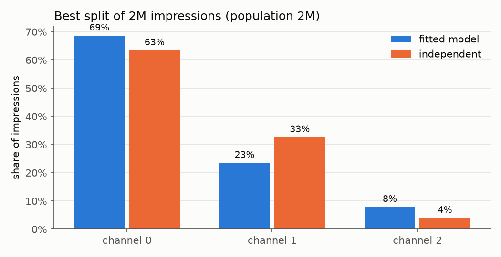

# Ising Deduplication

When advertising across several channels, what you usually know is how many people watch each channel and how many watch each *pair* of channels. What you don't know is how many watch any particular *combination*, and that's what reach depends on. Someone who watches three of the channels you're on should only be counted once. This project fills in the missing structure with the maximum entropy distribution that matches the pairwise numbers (an Ising model), then uses it to estimate deduplicated reach and to split a budget of impressions across channels.

**Summary:** fitting the model is straightforward when there are few enough channels to enumerate every combination (up to about 15-20, with a smaller learning rate past a handful). Past that it falls back to an MCMC estimate, which works but is noisy and slow. On the three channel example, using the overlap instead of assuming independence changes the estimated reach by up to a percentage point and changes the best split noticeably, but the reach that split gets is only slightly better (at most 0.4pp here), because reach is flat near the optimum.



The full write-up is in [notes/findings.md](notes/findings.md), and the notebook [notebooks/main.ipynb](notebooks/main.ipynb) has the code behind every number and plot.

## How it works

Each person is a 0/1 vector $x$ with one entry per channel (1 = watches it). The input is the co-viewing matrix $P_{ij} = \Pr(x_i = 1, x_j = 1)$, with the share watching each channel on the diagonal. Out of every distribution over $x$ with those pairwise probabilities, the one with the most entropy (the one that assumes the least beyond the data) has the form

$$p(x) \propto \exp\left(x^T M x\right),$$

which is an Ising model with fields on the diagonal of $M$ and pairwise couplings off it. $M$ is fitted by minimising the squared difference between the model's co-viewing matrix and $P$, with Adam or plain gradient descent. The model's co-viewing matrix is computed either:

- **exactly**, by summing over all $2^n$ combinations of channels, or
- **with a surrogate**, from a Metropolis-Hastings chain, differentiating through the acceptance probability.

For reach, impressions on a channel are spread evenly (Poisson) over the people who watch it, and each impression converts with some probability. The expected number of people converted at least once is then an average over the fitted distribution, and the split of the budget is optimised by gradient ascent on that.

## Quick start

```bash
git clone https://github.com/dbruwel/ising-deduplication.git
cd ising-deduplication
pip install -e .
```

Then in Python:

```python
import jax.numpy as jnp

from ising_deduplication import exact_moments, fit_with_adam, optimize_with_adam

# share watching both channel i and channel j (diagonal: share watching i)
target = jnp.array([[0.9, 0.78, 0.27], [0.78, 0.8, 0.2], [0.27, 0.2, 0.3]])

M, _ = fit_with_adam(target, method="exact")
print(exact_moments(M))  # matches target

impressions, (_, conversions) = optimize_with_adam(
    M,
    total_impressions=2_000_000,
    conversion_prob=jnp.ones(3) * 0.9,
    population_size=2_000_000,
    method="exact",
)
print(impressions, conversions[-1])
```

With more than about 15 channels, use `method="surrogate"`, and average the tail of the fitted path (`Ms[-200:].mean(axis=0)`) rather than taking the last step, since the surrogate fit is noisy.

To run the notebook or the tests:

```bash
pip install -e ".[notebook,dev]"
jupyter lab notebooks/main.ipynb
pytest
```

## Repository layout

```text
ising-deduplication/
├── notebooks/
│   └── main.ipynb          # fitting, deduplication and budget splits on an example
├── notes/
│   ├── findings.md         # the write-up
│   └── img/                # figures exported from the notebook
├── src/
│   └── ising_deduplication/
│       ├── __init__.py
│       ├── _descent.py     # Adam and gradient descent
│       ├── fitting.py      # fitting M to a co-viewing matrix
│       ├── optimize.py     # the reach model and budget split
│       └── sampler.py      # the Ising model, MCMC and exact enumeration
├── tests/
│   └── test_model.py
├── README.md
└── pyproject.toml
```
