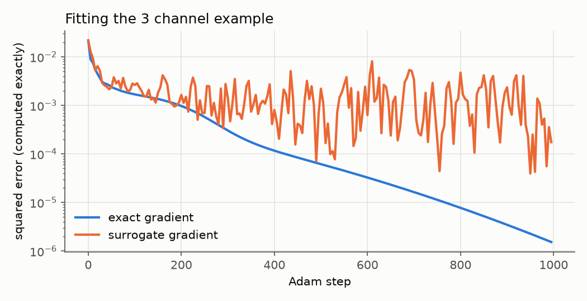

# Ising deduplication

When an ad campaign runs on several channels (TV networks, streaming services, sites), the number that matters is usually **reach**: how many different people see it at least once. Adding up each channel's audience counts anyone who watches more than one channel more than once, so the totals need to be *deduplicated*.

The data that's typically available doesn't make that easy. You can usually get the share of people who watch each channel, and the share who watch each *pair* of channels, but not the share who watch any particular combination of three or more. Reach depends on the full picture. The two common shortcuts are to ignore overlap entirely (overcounts) or assume people pick channels independently (ignores that, e.g., people who watch one sports channel tend to watch the others).

The idea here is to fill in the gaps with the **maximum entropy** distribution: out of everything consistent with the pairwise data, take the one that assumes the least beyond it. That turns out to be an Ising model. Once it's fitted, reach for any plan is an average over it, and the split of a budget across channels can be optimised by gradient ascent.

**Summary:** the model is easy to fit exactly for up to about 15-20 channels, by enumerating every combination (past a handful of channels the default learning rate needs turning down). Past that, an MCMC-based surrogate works but is noisy (a few percentage points off at the last step, around 0.5-2pp if you average the last few hundred steps) and takes a minute or so however many channels there are. On the three-channel example, accounting for overlap changes estimated reach by up to about a percentage point compared with assuming independence. It also changes the recommended split a fair bit (channel 2 gets about twice the share). The reach that split actually achieves is at most 0.4pp better, because reach is flat near the optimum. All of this is on made-up numbers. Nothing has been checked against real viewing data.

The numbers and plots below come from [`notebooks/main.ipynb`](../notebooks/main.ipynb).

## The setup

There are $n$ channels. A person is a 0/1 vector $x$ with one entry per channel ($x_i = 1$ means they watch channel $i$). The data is the **co-viewing matrix**

$$P_{ij} = \Pr(x_i = 1, x_j = 1),$$

which has the share watching each channel on the diagonal (since $x_i^2 = x_i$). The running example has three channels:

| | channel 0 | channel 1 | channel 2 |
|---|---:|---:|---:|
| **channel 0** | 0.90 | 0.78 | 0.27 |
| **channel 1** | 0.78 | 0.80 | 0.20 |
| **channel 2** | 0.27 | 0.20 | 0.30 |

If people chose channels independently, the share watching both 0 and 1 would be $0.9 \times 0.8 = 0.72$. It's 0.78, so those two overlap more than chance. Channels 1 and 2 overlap less than chance (0.20 vs 0.24), and channels 0 and 2 are about at chance (0.27 vs 0.27).

### Maximum entropy gives an Ising model

There are $2^n$ possible $x$'s, and the data only pins down $n(n+1)/2$ numbers about their distribution, so there are many distributions that fit. The maximum entropy one solves

$$\max_p \; -\sum_x p(x)\ln p(x) \quad \text{subject to} \quad \sum_x p(x)\, x_i x_j = P_{ij} \text{ for all } i \le j, \quad \sum_x p(x) = 1.$$

Setting the derivative of the Lagrangian to zero gives $\ln p(x) = \sum_{i \le j} \lambda_{ij} x_i x_j + \text{const}$, which can be written as

$$p(x) \propto \exp\left(x^T M x\right)$$

for a symmetric matrix $M$. Because $x$ is binary, the diagonal $M_{ii}$ acts as a per-channel field (how popular the channel is) and the off-diagonal $M_{ij}$ as a coupling (positive if watching one makes the other more likely). This is the Ising model, with 0/1 spins instead of $\pm 1$.

It's an exponential family, so if some $M$ reproduces $P$ exactly then it's the unique such $M$, and it's the maximum entropy distribution. "Maximum entropy" here means "no structure beyond pairs". Any three-way pattern in the real data that isn't implied by the pairs is lost.

## Fitting

$M$ is found by minimising the squared error between the model's co-viewing matrix and the target,

$$L(M) = \sum_{i,j} \left(\mathbb{E}_M[x_i x_j] - P_{ij}\right)^2,$$

starting from the **independent** model, $M = \operatorname{diag}(\operatorname{logit} P_{ii})$, which gets the diagonal right with no couplings. The optimiser is Adam (or plain gradient descent). The hard part is $\mathbb{E}_M[x_i x_j]$, and there are two ways of getting it.

### Exact

Enumerate all $2^n$ possible $x$'s, compute $\exp(x^T M x)$ for each, normalise, and sum. JAX differentiates through it. This is exact and fast for small $n$ (well under a second for up to 10 channels), but the cost doubles with every channel, so it stops being practical somewhere around 20.

### Surrogate (MCMC)

Run a Metropolis-Hastings chain on the model, proposing to flip one random channel at each step. From state $x$ with proposal $x'$, the move is accepted with probability $\alpha = \min(1, e^{x'^T M x' - x^T M x})$, so the expected value of the next sample's $x x^T$ is

$$\alpha\, x' x'^T + (1-\alpha)\, x x^T.$$

Averaging that over the chain estimates $\mathbb{E}_M[x x^T]$, and it depends smoothly on $M$ through $\alpha$, so it can be differentiated. Each Adam step runs a fresh 10,000-step chain.

This isn't the exact gradient. The states of the chain are held fixed, so it ignores how the whole distribution moves when $M$ changes, and only picks up the one-step effect through $\alpha$. Comparing with the exact gradient on the example:

| | cosine with exact gradient (single chain) | cosine (mean of 20 chains) | size relative to exact |
|---|---:|---:|---:|
| at the independent start | 0.79-1.00 | 0.973 | 0.49 |
| at a random $M$ | 0.99-1.00 | 0.997 | 0.38 |

On average it points almost the same way as the exact gradient but is about half as big. Adam rescales each step anyway, so the size doesn't matter much. A single chain can be noticeably off though.

### How well does it fit?

With the exact gradient the loss keeps dropping, and after 1000 steps every entry of the model's co-viewing matrix is within 0.06pp of the target. With the surrogate it gets down to around $10^{-3}$ to $10^{-4}$ quickly and then bounces around there, because every step uses a new noisy chain and the learning rate stays fixed.

| | worst error in the co-viewing matrix |
|---|---:|
| exact | 0.06pp |
| surrogate, last step | 1.2pp |
| surrogate, average of the last 200 steps | 0.4pp |

So with the surrogate it's worth averaging the tail of the path rather than taking the last step. A decaying learning rate would probably do the same job.

Checking the fit with a fresh MCMC chain isn't a good test either. A 10,000-step chain has a standard error of around 0.5-1pp on each entry, about as big as the errors being checked. For example, the surrogate fit's share watching both 0 and 1 is 76.8% exactly. One fresh chain says 77.7%, against a target of 78%.

### Plain gradient descent

With the default settings (learning rate 0.1, 1000 steps), plain gradient descent is still about 3pp off with either gradient. The loss is small and flat, so the gradient is tiny. It gets there eventually with more steps or a bigger learning rate, but Adam is the better default.

### More channels

A random "true" model with $n$ channels, using its exact co-viewing matrix as the target, fitted with the defaults:

| channels | method | time | worst error, last step | worst error, avg of last 200 |
|---:|---|---:|---:|---:|
| 6 | exact | 0.4s | 0.1pp | 0.0pp |
| 6 | surrogate | 86s | 1.7pp | 0.5pp |
| 10 | exact | 0.5s | 0.2pp | 0.1pp |
| 10 | surrogate | 79s | 2.9pp | 0.8pp |
| 14 | exact | 2.4s | 3.2pp | 3.3pp |
| 14 | surrogate | 73s | 5.9pp | 1.9pp |

The surrogate's cost is set by the chain length (1000 steps × 10,000 MCMC steps), not the number of channels, so it takes a minute or so regardless. Its error grows with $n$, since the same chain length has to estimate more entries.

The exact method's poor result at 14 channels isn't the method itself, it's the learning rate. At 0.1 it's too big. Running for 5000 steps at 0.1 makes it worse (it diverges, worst error 43pp), while 0.01 gets to 0.9pp after 1000 steps and 0.4pp after 5000. So for more than a handful of channels, a smaller learning rate is needed.

## The reach model

Take a population of $N$ people, with each person's channels drawn from the fitted model. Buying $I_j$ impressions on channel $j$, the impressions are spread evenly over the $N p_j$ people who watch it, where $p_j = P_{jj}$. So each viewer of channel $j$ gets a Poisson number of impressions with mean $I_j / (N p_j)$. If each impression converts with probability $q_j$ (set $q_j = 1$ for plain reach), a person with channels $x$ is converted at least once with probability

$$1 - \exp\left(-\sum_j x_j \frac{q_j I_j}{N p_j}\right),$$

and the expected number of people converted is $N$ times the average of that over $x$. The average is either exact (sum over every $x$, weighted by the model) or over a fixed MCMC sample.

Treating everyone who watches a channel the same is a big simplification. In practice some people watch a channel a lot and some barely at all, and the heavy viewers soak up most of the impressions. That would lower reach for a given budget compared with this model.

## Deduplication

With the model fitted to the example, the share of people who watch none of the three channels is **5.0%**. Under independence it's **1.4%**. The positive overlap between channels 0 and 1 piles their audiences onto the same people, leaving more people with nothing.

The reach for a few plans (2M people, 0.9 conversion probability per impression):

| impressions on channels 0 / 1 / 2 | fitted model | independent |
|---|---:|---:|
| 1M / 1M / 0 | 56.7% | 57.6% |
| 1M / 0 / 1M | 50.5% | 50.5% |
| 1M / 1M / 1M | 67.7% | 67.5% |

Spending on channels 0 and 1 together, independence overestimates reach by about a percentage point, because a lot of their audiences are the same people. For 0 and 2, which overlap at about chance, the two models agree. With all three, the fitted model is slightly higher, since channel 2 reaches people the other two miss more than independence would suggest.

These differences are small, but so is the example. Three channels with mostly large audiences don't leave much room for overlap to matter. Many channels with small, strongly overlapping audiences would show bigger differences.

## Optimising the split

The split is parameterised as $I = T \cdot \operatorname{softmax}(\theta)$ so it always adds to the budget $T$, and $\theta$ is optimised with Adam, starting from an even split. Each split below is then scored with the fitted model.

| budget | best split, fitted model | best split, independent | reach, fitted split | reach, independent split | reach, even split |
|---:|---|---|---:|---:|---:|
| 100k | 75 / 19 / 6 | 67 / 30 / 3 | 4.39% | 4.39% | 4.37% |
| 1M | 72 / 21 / 7 | 65 / 31 / 4 | 35.53% | 35.49% | 34.50% |
| 2M | 69 / 23 / 8 | 63 / 33 / 4 | 57.30% | 57.19% | 54.94% |
| 5M | 60 / 29 / 11 | 59 / 35 / 5 | 84.47% | 84.11% | 81.45% |

The fitted model moves impressions away from channel 1 (which mostly reaches people channel 0 already reaches) and towards channel 2 (which reaches people the others don't). That's the expected direction. But the reach the two splits achieve differs by at most 0.4pp. Near the optimum, reach is flat in the split, so getting the split "wrong" by a few points costs very little. The even split costs more (up to 3pp here), mostly because it ignores how big each channel's audience is.

The surrogate version of the optimiser (averaging over a 10,000-person MCMC sample instead of every combination) lands within a few points of the exact split and within 0.02pp of its reach.

At the 100k budget everything is nearly linear (very few people see more than one impression), so overlap barely matters and every sensible split does about the same.

## Things I didn't get to

- **The likelihood gradient.** The usual way of fitting a maximum entropy model is to maximise the likelihood (the dual of the entropy problem). Its gradient is just $P_{ij} - \mathbb{E}_M[x_i x_j]$, and the problem is convex. That would avoid the surrogate gradient's approximation entirely, and the expectation can be estimated with plain MCMC (Boltzmann machine learning).
- **Tail averaging or a decaying learning rate**, built into the fitting functions instead of done by hand.
- **Checking the target is consistent.** Not every symmetric matrix of probabilities is the co-viewing matrix of some population (e.g. $P_{ij}$ can't exceed $\min(P_{ii}, P_{jj})$, and there are subtler conditions with three or more channels). Numbers stitched together from different sources might not be, in which case the loss can't get to zero and the fit is a compromise.
- **Heavy and light viewers.** Replacing "watches / doesn't watch" with a few viewing levels (a Potts model) would let impressions concentrate on heavy viewers.
- **Effective frequency.** Optimising for people seeing the ad at least $k$ times instead of at least once.
- **Real data.** Everything here uses made-up numbers.

## Changes when tidying up

Going back over the code turned up a few things:

- **The notebook's fit check was misleading.** It compared a single fresh MCMC chain against the target (78.2% vs 78.0%), but the chain's own noise is about 1pp. Computed exactly, the fitted model had 80.6%. Taking the last step of a noisy surrogate fit was the issue (see [How well does it fit?](#how-well-does-it-fit)).
- **`optimize_with_sgd` put everything on one channel.** The objective was the number of people converted, so its gradient scaled with the population size (millions), and a learning rate of 0.1 jumped straight to a corner. The objective is now the *share* converted, and the default learning rate for this function is 10.
- **The surrogate optimiser drew its MCMC sample twice.** Harmless, just wasted time.
- **`run_ising_chain` used the same random key** for the starting state and the chain. Now they're split.
- **An unrecognised `method` failed with an unbound variable error** deep inside a JAX trace. It now raises a `ValueError` straight away.
